# Aether: Ultra-low-latency Matching Engine

A miniature electronic exchange: price-time priority matching across multiple instruments,
with a custom order book, a memory pool, and deterministic event replay.

Headline numbers you will measure:

| Metric | Meaning |
|---|---|
| **Orders/sec** | Throughput: how many commands the engine finishes per second under sustained load |
| **p50 / p99 / p99.9** | Latency per command: typical case, 1-in-100 worst, 1-in-1000 worst |
| **Allocations per order** | Heap allocations on the hot path. Target in steady state: exactly **0** |

This document gives you diagrams, pseudocode and type signatures. The code is yours to write.

> Diagrams are **Mermaid**. They render on GitHub, and in VS Code with the
> "Markdown Preview Mermaid Support" extension (open preview with `Cmd+Shift+V`).

---

## Contents

1. [The big picture](#1-the-big-picture)
2. [Vocabulary](#2-vocabulary)
3. [Price-time priority](#3-price-time-priority)
4. [Order lifecycle](#4-order-lifecycle)
5. [Data structures](#5-data-structures)
6. [Memory pool](#6-memory-pool)
7. [Threads and the SPSC ring buffer](#7-threads-and-the-spsc-ring-buffer)
8. [Deterministic event replay](#8-deterministic-event-replay)
9. [Measuring the three headline numbers](#9-measuring-the-three-headline-numbers)
10. [Build plan](#10-build-plan)
11. [Repo layout](#11-repo-layout)

---

## 1. The big picture

Clients send orders. Something has to put every order into one global order, write that
order to disk, then hand it to the matcher. The matcher keeps one order book per instrument and
turns each command into output events (acks, trades, cancels).

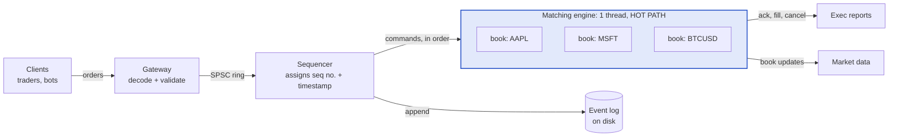

**Key idea:** the engine never touches the network or the disk. It reads ordered commands from
one queue and writes events to another. That isolation makes it fast *and* makes replay possible.

---

## 2. Vocabulary

| Term | Meaning | In Aether |
|---|---|---|
| Instrument | The thing traded (AAPL, BTCUSD) | `uint32_t instrument_id`, one book each |
| Side | Buy (bid) or sell (ask) | `enum class Side : uint8_t` |
| Tick | Smallest price step, e.g. 0.01 | Prices are `int64_t` tick counts. **Never `double`** |
| Limit order | "Buy 100 at 101.02 or better." Leftover rests in the book | `OrderType::Limit` |
| Market order | "Buy 100 at any price." Never rests | `OrderType::Market` |
| IOC | Immediate-or-cancel: has a limit price, leftover is cancelled | `OrderType::IOC` |
| Best bid / ask | Highest buy price / lowest sell price | Cached, updated on every change |
| Spread | Best ask − best bid. Always > 0 in a resting book | If an order would make it ≤ 0, it matches |
| Maker / taker | Maker = resting order. Taker = incoming order that hits it | Trade price = **maker's** price |
| Fill / partial | Trade completes all / part of an order | One `Trade` event per maker touched |
| Cancel / modify | Remove an order / change it | Qty down keeps priority. Price change or qty up loses it |

---

## 3. Price-time priority

Two rules decide who trades first:

- **Price first:** the better price always trades first (highest bid, lowest ask).
- **Time second:** at the same price, whoever arrived first trades first.

So each price level is a **FIFO queue**, and the book is a **sorted collection of those queues**.

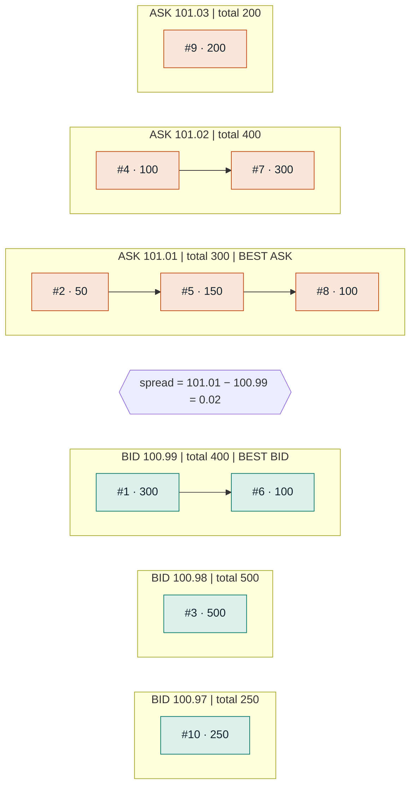

How to read it:

- Each box is `#id · qty`. Ids were assigned in arrival order.
- Arrows inside a level go **front → back** of the queue. The leftmost order fills first.
- That's why #2 is ahead of #5 and #8 at 101.01.

### Walkthrough: incoming `Buy 450 @ 101.02`

A buyer looks at the **ask** side, starting from the best ask:

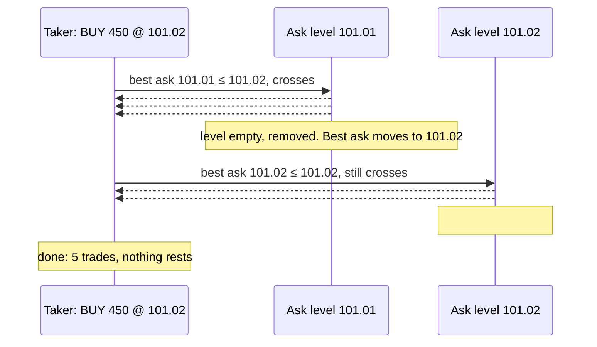

Book after:

| Side | Price | Queue |
|---|---|---|
| ASK | 101.03 | #9 · 200 |
| ASK | 101.02 | #7 · 250  ← new best ask |
| BID | 100.99 | #1 · 300, #6 · 100 |
| BID | 100.98 | #3 · 500 |
| BID | 100.97 | #10 · 250 |

- If it had been **Buy 800**, after sweeping 700 the leftover 100 would **rest** as a new bid
  at 101.02 and become the best bid.
- Trades print at the **resting (maker) order's price**, 101.01, not the taker's limit 101.02.
  The taker gets the better price.

### The matching loop as a flowchart

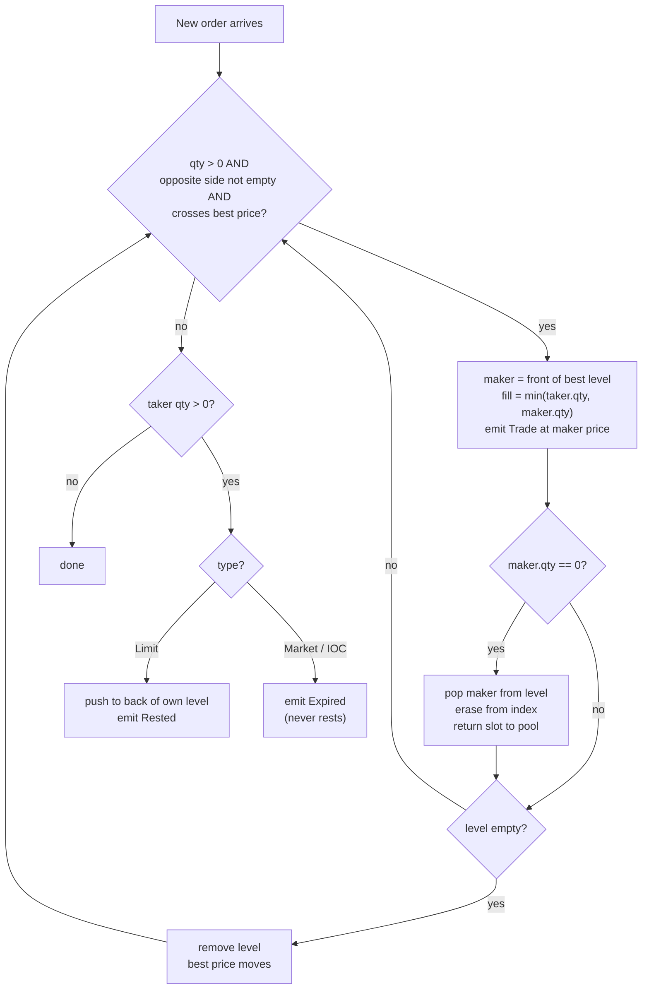

### Same thing as pseudocode

```text
on_new_order(o):
    opp = (o.side == Buy) ? asks : bids
    while o.qty > 0 and !opp.empty() and crosses(o, opp.best_price()):
        level   = opp.best_level()
        maker   = level.front()                    // time priority
        fill    = min(o.qty, maker.qty)
        emit Trade{ buyer, seller, price = level.price, qty = fill }
        o.qty  -= fill;  maker.qty -= fill;  level.total -= fill
        if maker.qty == 0: level.pop_front(); index.erase(maker.id); pool.free(maker)
        if level.empty():  opp.remove_level(level)  // best price moves
    if o.qty > 0:
        if o.type == Limit: own_side.level(o.price).push_back(o); emit Rested
        else:               emit Expired{ o.qty }   // Market / IOC never rest

crosses(o, p) = (o.type == Market) or (o.side == Buy ? p <= o.price : p >= o.price)

on_cancel(id):
    o = index.find(id)            // O(1)
    if !o: emit Reject; return
    o.level.unlink(o)             // O(1), intrusive list
    if o.level.empty(): remove_level(o.level)
    index.erase(id); pool.free(o); emit Canceled
```

Everything else in this project is about making this loop fast.

---

## 4. Order lifecycle

Every order is in exactly one of these states. Your events (`Ack`, `Trade`, `Rested`,
`Expired`, `Canceled`, `Reject`) are the arrows.

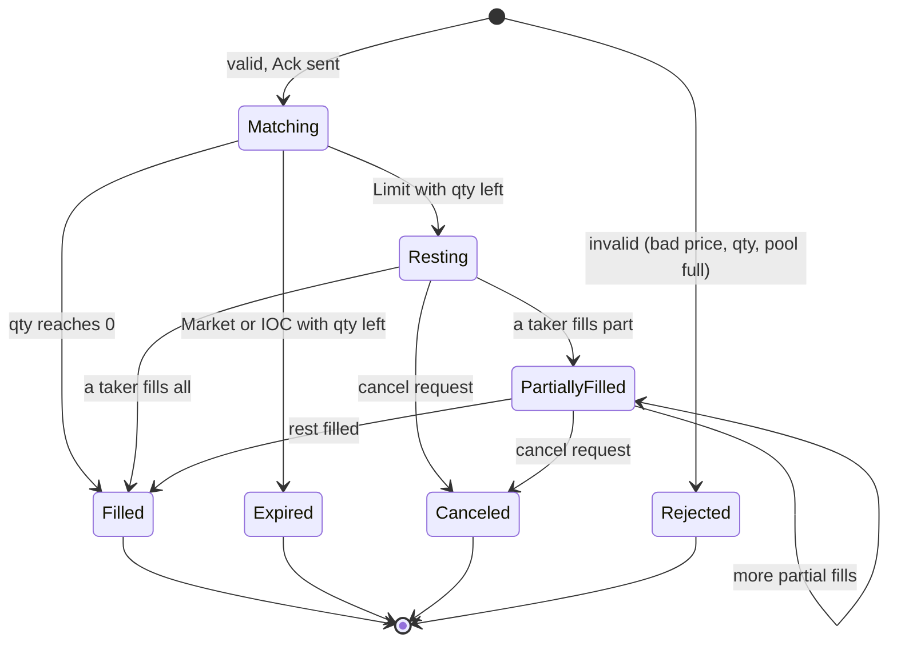

Modify rules: **qty down** = stay in place (keep priority). **Price change or qty up** =
cancel + new order (goes to the back of the queue).

---

## 5. Data structures

The naive book is `std::map<Price, std::list<Order>>`. It is correct and you should **write it
first**. It is slow because every new order and every new price level calls `new`, and every
lookup chases pointers across memory.

The fast book needs three operations to be cheap:

| Operation | When | Target |
|---|---|---|
| Find best price | Every incoming order | O(1) |
| Push back / pop front at one price | Every rest / fill | O(1), no allocation |
| Cancel by id | Every cancel | id → pointer, then O(1) unlink |

### Book → PriceLevel → intrusive list of Orders

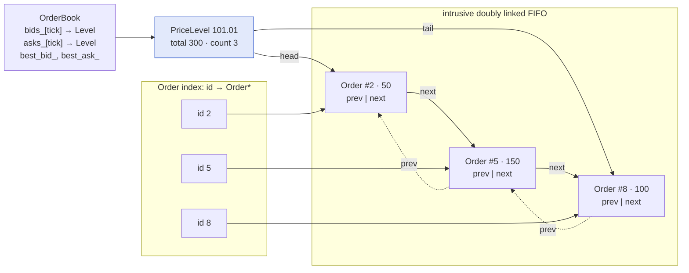

- **Intrusive list:** each `Order` carries its own `prev`/`next` pointers, so no separate list
  node is ever allocated.
- **Cancel #5:** look up id 5 in the index → set `#2.next = #8` and `#8.prev = #2`. No search.

### Where price levels live: tree vs flat array

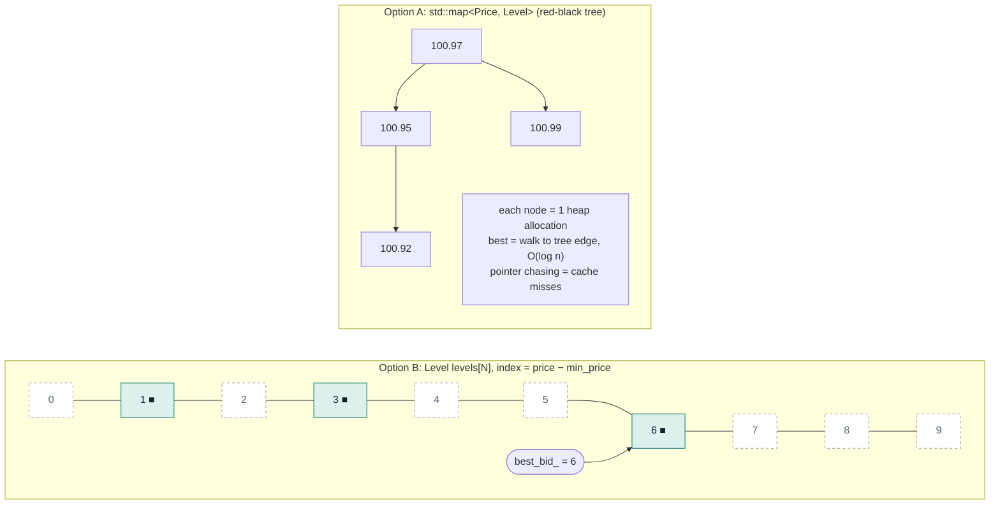

| | `std::map` | Flat array |
|---|---|---|
| Find best | O(log n), pointer walk | O(1), cached index |
| New level | heap allocation | none (allocated once) |
| Memory | only used levels | whole price band |
| Catch | slow | bounded price range; when best level empties, scan to next filled cell |

The flat array works because a real instrument trades in a known band (say ±20% around a
reference price, in ticks). Later, a bitmap of non-empty levels makes "find next filled cell"
very fast.

### Type sketches (bodies are yours)

```cpp
// types.hpp
using Price   = std::int64_t;     // ticks, e.g. 101.02 with tick 0.01 -> 10102
using Qty     = std::int64_t;
using OrderId = std::uint64_t;
enum class Side      : std::uint8_t { Buy, Sell };
enum class OrderType : std::uint8_t { Limit, Market, IOC };

struct PriceLevel;
struct Order {                    // aim for one 64-byte cache line
    OrderId       id;
    Price         price;
    Qty           qty;            // remaining
    std::uint64_t seq;            // arrival sequence = time priority
    Order*        prev  = nullptr;// intrusive FIFO links
    Order*        next  = nullptr;
    PriceLevel*   level = nullptr;// back-pointer for O(1) cancel
    std::uint32_t instrument;
    Side          side;
    OrderType     type;
};

struct PriceLevel {
    Order*        head  = nullptr;  // oldest, fills first
    Order*        tail  = nullptr;  // newest, push here
    Qty           total = 0;
    std::uint32_t count = 0;
    void push_back(Order*);
    void unlink(Order*);
    bool empty() const;
};
```

### Class diagram

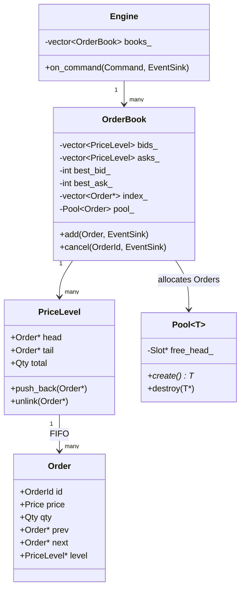

---

## 6. Memory pool

`new`/`delete` go to the general-purpose allocator. Usually fast, but occasionally it takes a
lock, asks the OS for pages, or walks a fragmented free list. Those occasional slow calls are
exactly what shows up at **p99.9**.

A pool allocates one big array of `Order` slots at startup. After that, getting and returning
an order is two pointer moves.

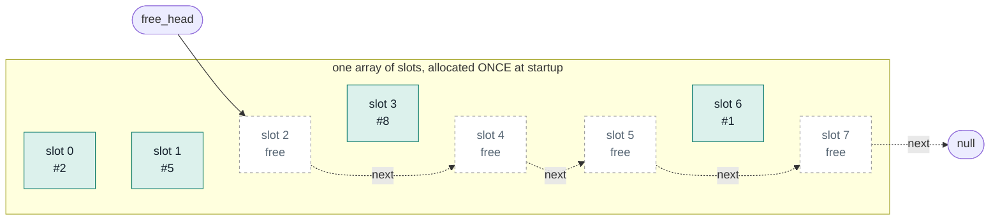

A free slot reuses its own bytes to store the "next free" pointer, so the list costs no extra
memory.

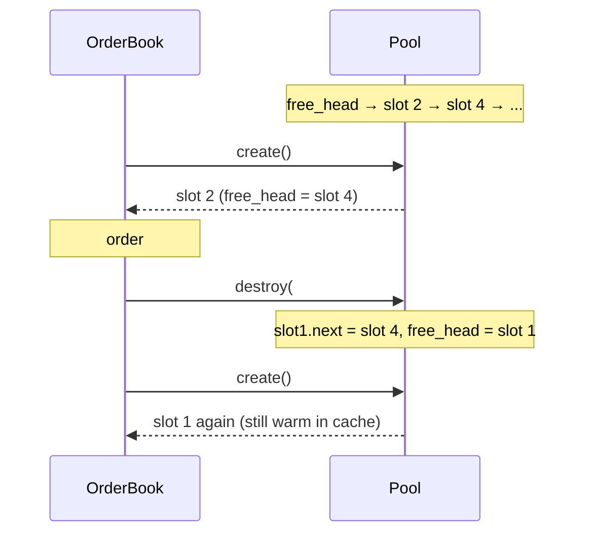

```
allocate():                         deallocate(p):
    slot      = free_head               p->next   = free_head
    free_head = free_head->next         free_head = p
    return slot
```

Both O(1). No lock needed (only the engine thread touches it).

```cpp
template <class T>
class Pool {
public:
    explicit Pool(std::size_t capacity);   // the ONLY allocation; build the free list here
    template <class... Args>
    T*   create(Args&&... args);           // pop free list, std::construct_at(slot, args...)
    void destroy(T* p) noexcept;           // std::destroy_at(p), push slot on free list
    std::size_t in_use() const noexcept;
private:
    union Slot { Slot* next; alignas(T) std::byte storage[sizeof(T)]; };
    std::unique_ptr<Slot[]> slots_;
    Slot* free_head_ = nullptr;
};
```

> **Decide what happens when the pool is empty.** A real exchange rejects the order
> ("book full") rather than calling `new`. Make it a test case.

Other hidden allocations to remove from the hot path:

- `std::unordered_map` inserts → `reserve()` up front, or use a vector indexed by order id
- `std::vector::push_back` for output events → fixed pre-sized buffer
- `std::string` anywhere in the hot path
- `std::function` with captures

---

## 7. Threads and the SPSC ring buffer

Books for different instruments never share state. Simplest correct design:
**one engine thread owns all books** and processes commands one at a time. No locks inside the
engine. Other threads talk to it via **single-producer single-consumer (SPSC) ring buffers**,
which need only two atomic indexes.

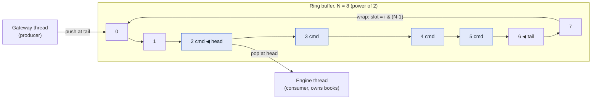

The memory-ordering handshake (this is the part people get wrong):

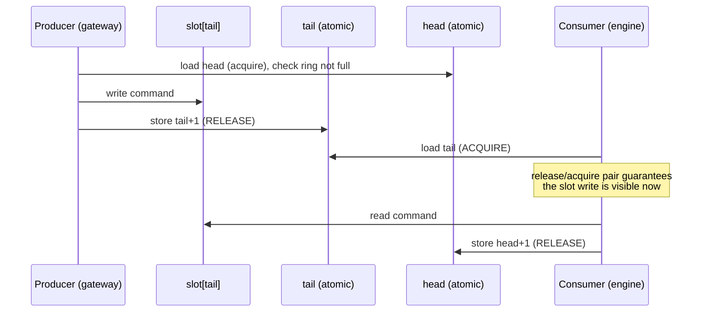

Rules:

- Put `head` and `tail` on **separate 64-byte cache lines** (`alignas(64)`), otherwise the two
  cores fight over one line (false sharing).
- Capacity N is a power of two so wrap is a mask, not a modulo.

| Start here | Later, if you want more |
|---|---|
| 1 gateway, 1 engine, 1 publisher thread | Shard: N engine threads, instrument `i` → thread `i % N`, one ring each |
| Engine holds `std::vector<OrderBook>` indexed by instrument id | Still deterministic: each book sees only its own ordered stream |
| Spin-wait on the ring (burns a core, saves µs) | macOS can't hard-pin threads to cores; Linux can (`pthread_setaffinity_np`) |

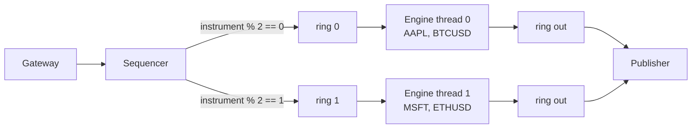

(The sharded version above is an optional later step.)

---

## 8. Deterministic event replay

If the engine is a **pure function of its ordered input**, you can record the input once and
rerun it any time: debug a crash, recover after restart, or prove an optimisation changed
nothing.

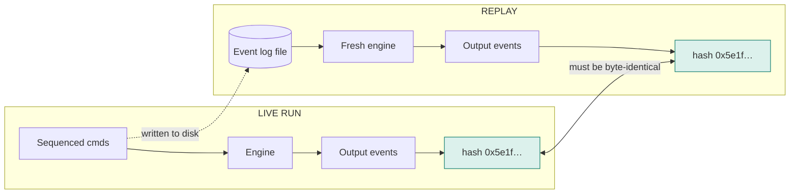

The log stores **inputs only**. Outputs are recomputed, so any nondeterminism inside the engine
is a bug.

### What breaks determinism

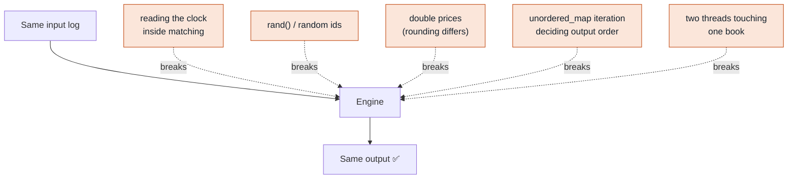

Rules:

- The engine reads nothing but the command stream. No clock reads, no `rand()`, no environment.
- Timestamps come from the sequencer and are stored in the log.
- Order ids come from a counter or from the log.
- Integer prices only.
- One thread per book, so thread scheduling never decides order.

### Log record format

```cpp
struct LogRecord {               // 48 bytes, written raw
    std::uint64_t seq;
    std::uint64_t ts_ns;         // from sequencer
    std::uint8_t  type;          // New, Cancel, Modify
    std::uint8_t  side, order_type, pad;
    std::uint32_t instrument;
    std::int64_t  price, qty;
    std::uint64_t order_id;
};
static_assert(sizeof(LogRecord) == 48);
```

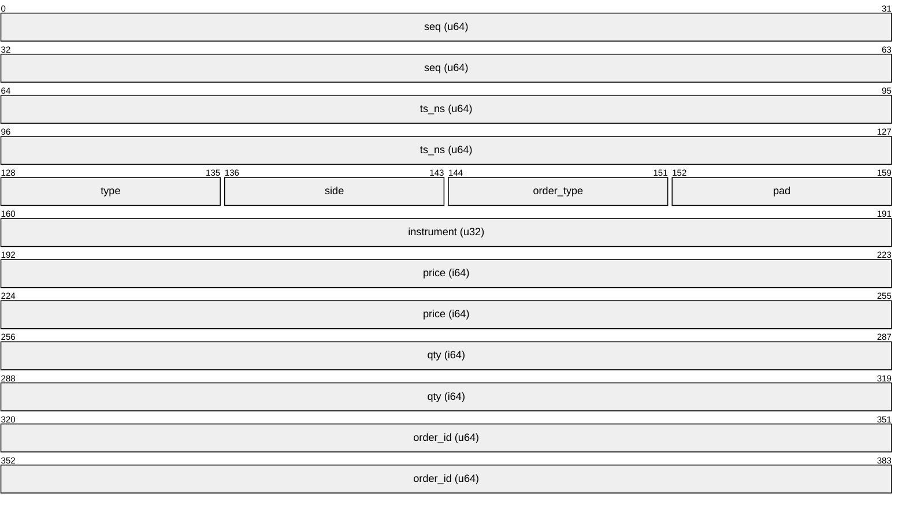

Test: hash every output event (FNV-1a is fine), replay the log into a fresh engine, compare.

---

## 9. Measuring the three headline numbers

### Latency percentiles: why p99.9 matters more than the average

Record how long each command takes (engine dequeue → last output event written). Sort all
durations: **p50** is the middle one, **p99** is beaten by 99% of commands, **p99.9** by 99.9%.

Example distribution of 200,000 commands (illustrative numbers):

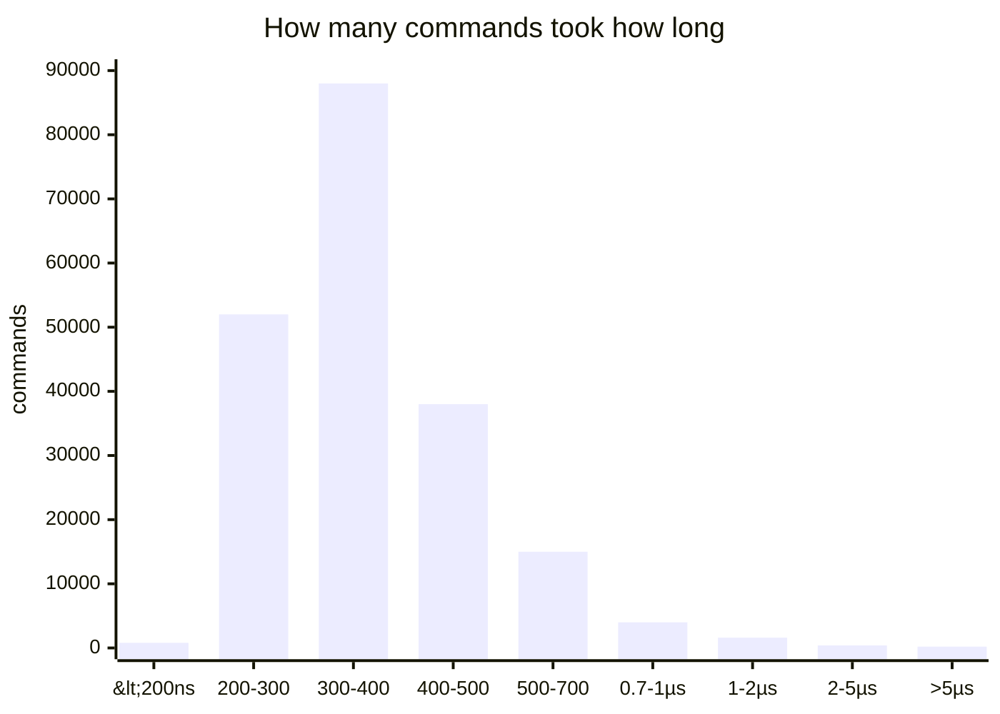

The bars on the right are almost invisible, but that's where the pain is. Same data as
percentiles:

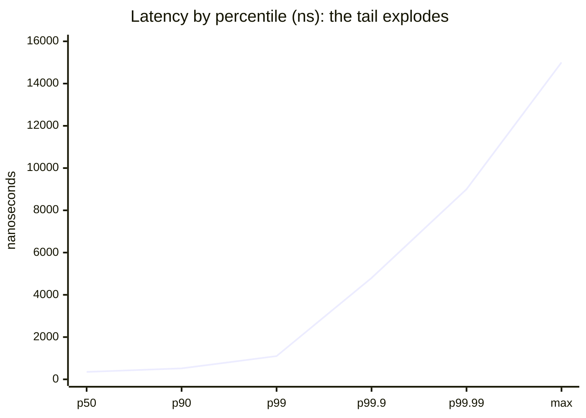

Most commands are fast. Cache misses, page faults and OS interrupts create the long tail, and
that tail is what a trader feels on a busy day. An average hides it completely.

### Where the clock starts and stops

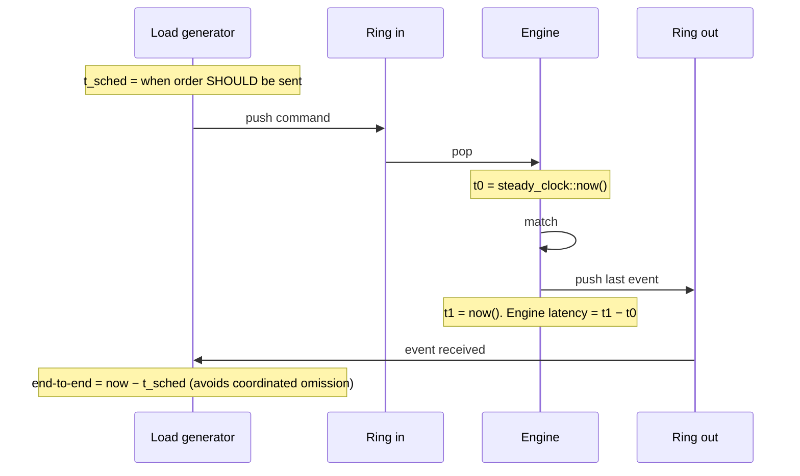

### How to measure each metric

| Metric | How | Traps |
|---|---|---|
| **Orders/sec** | Pre-generate N = 10M commands from a **seeded** RNG (~60% new limit, 30% cancel, 10% aggressive). Time the engine processing all of them. N / seconds. Run 3+ times, report median. | Generating orders inside the timed loop measures the generator. Do a warm-up run first. |
| **p50/p99/p99.9** | `std::chrono::steady_clock` before/after each command. Record into a **pre-allocated log-scale histogram** (HdrHistogram style), never a growing vector. | **Coordinated omission:** if the load generator waits for each reply before sending the next, slow periods send fewer orders and hide themselves. Send on a fixed schedule; measure from the *scheduled* send time for end-to-end numbers. |
| **Allocations/order** | Replace global `operator new` with a counting version in the bench binary. allocs in timed window ÷ commands. | Count only after warm-up (pools allocate at startup on purpose). Target: `0.000`. |

```cpp
// bench/alloc_counter.cpp — link only into the benchmark
inline std::atomic<std::uint64_t> g_allocs{0};

void* operator new(std::size_t n) {
    g_allocs.fetch_add(1, std::memory_order_relaxed);
    if (void* p = std::malloc(n)) return p;
    throw std::bad_alloc{};
}
void operator delete(void* p) noexcept              { std::free(p); }
void operator delete(void* p, std::size_t) noexcept { std::free(p); }
```

> **Mac notes:** `rdtsc` is x86-only; on Apple Silicon use `steady_clock` (reads the ARM system
> counter, ~40 ns resolution). Profile with Instruments (Time Profiler, Allocations). Always
> report machine, compiler and flags next to every number.

---

## 10. Build plan

Order matters: **correctness → a way to measure → speed.** The slow version you write first
becomes the oracle every fast version is checked against.

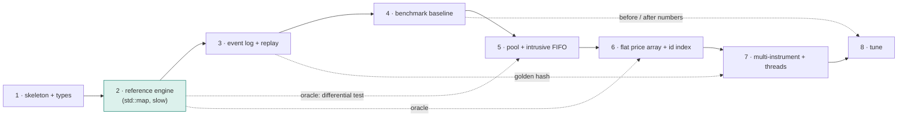

1. **Project skeleton and types.** CMake, C++20, GoogleTest. `types.hpp`, command/event structs.
   Debug build with `-fsanitize=address,undefined`, Release with `-O3`.
   *Done when:* an empty test runs in both builds.

2. **Reference engine (slow, obviously correct).** One book: `std::map<Price, std::deque<Order>>`
   per side + `std::unordered_map` for id lookup. Limit, Market, IOC, cancel, modify.
   *Done when:* hand-written tests pass, including the walkthrough (Buy 450 @ 101.02 → exactly 5 trades).

3. **Event log and replay.** Binary `LogRecord` writer/reader. `replay` tool prints FNV-1a hash
   of all output events.
   *Done when:* record + replay of 1M random commands gives the same hash; golden-hash test in CI.

4. **Benchmark harness.** Seeded load generator, timed loop, log-scale histogram, alloc counter.
   Prints orders/sec, p50/p99/p99.9, allocs/order.
   *Done when:* baseline numbers for the reference engine are written down.

5. **Memory pool + intrusive FIFO.** Write `Pool<T>` and intrusive `PriceLevel`. New `OrderBook`
   uses them; keep the reference one.
   *Done when:* differential test (both engines, same random stream) matches and allocs/order = 0.

6. **Flat price array + id index.** Tick-indexed array with cached best indexes; vector indexed
   by order id instead of hash map.
   *Done when:* differential test passes and p99.9 has dropped vs milestone 4.

7. **Multiple instruments + threads.** Book per instrument, SPSC rings in/out, gateway and
   publisher threads.
   *Done when:* replaying a multi-instrument log through the threaded build gives the same hash
   as single-threaded.

8. **Tune.** Cache-line align hot structs, check `sizeof(Order)`, reduce branches in the match
   loop, bitmap for next non-empty level. Profile before each change.
   *Done when:* every improvement has a before/after number.

### Differential test (milestones 5 and 6)

```mermaid
flowchart LR
    SEED["seeded random<br/>command stream"] --> REF["Reference engine<br/>(std::map)"] --> HR["events"]
    SEED --> FAST["Fast engine<br/>(pool + array)"] --> HF["events"]
    HR --> CMP{"identical?"}
    HF --> CMP
    CMP -- yes --> OK["pass ✅"]
    CMP -- no --> BUG["print first differing event<br/>+ seed → reproducible bug"]
```

---

## 11. Repo layout

```
aether/
├── CMakeLists.txt
├── include/aether/
│   ├── types.hpp         Price, Qty, OrderId, Side, OrderType
│   ├── events.hpp        Command in; Event out (Ack, Trade, Rested, Expired, Canceled, Reject)
│   ├── order.hpp         Order with intrusive prev/next
│   ├── pool.hpp          fixed-capacity object pool
│   ├── price_level.hpp   FIFO of orders at one price
│   ├── order_book.hpp    one instrument: bids, asks, best prices, id index
│   ├── engine.hpp        instrument id → book, command dispatch
│   ├── event_log.hpp     LogRecord writer / reader
│   └── spsc_ring.hpp     lock-free single-producer single-consumer queue
├── src/                  .cpp files + main.cpp
├── reference/            slow std::map engine, kept as the test oracle
├── tests/                unit, differential fuzz, replay golden hash
├── bench/                load generator, latency histogram, alloc counter
└── tools/replay.cpp      replay a log file, print output hash
```

Which header includes which (write them bottom-up):

```mermaid
flowchart BT
    types["types.hpp"]
    events["events.hpp"] --> types
    order["order.hpp"] --> types
    pool["pool.hpp"]
    level["price_level.hpp"] --> order
    book["order_book.hpp"] --> level
    book --> pool
    book --> events
    engine["engine.hpp"] --> book
    log["event_log.hpp"] --> events
    ring["spsc_ring.hpp"]
    main["main.cpp"] --> engine
    main --> log
    main --> ring
```

Start with milestone 1: `types.hpp` and `events.hpp`.
